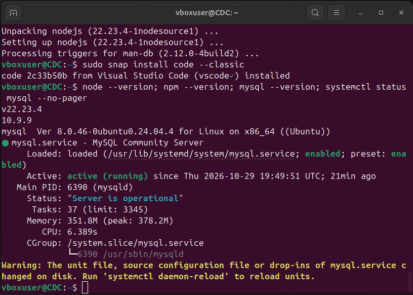
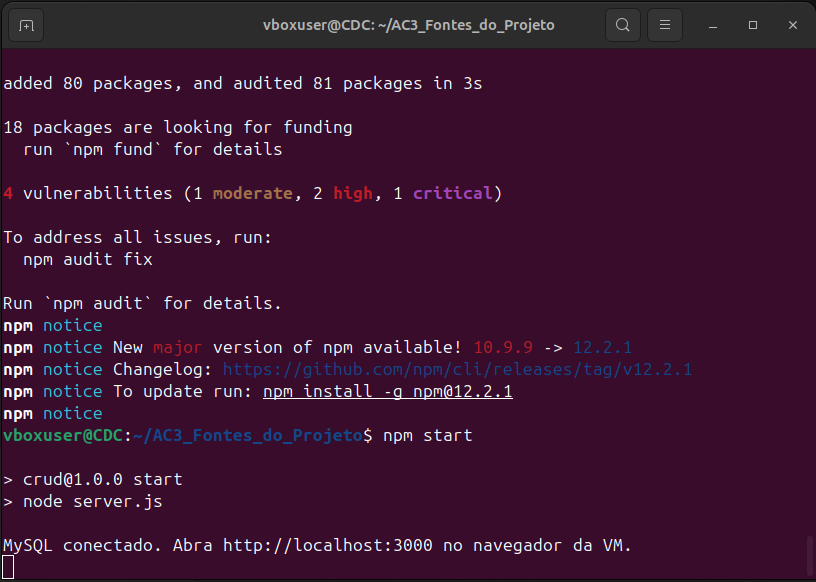
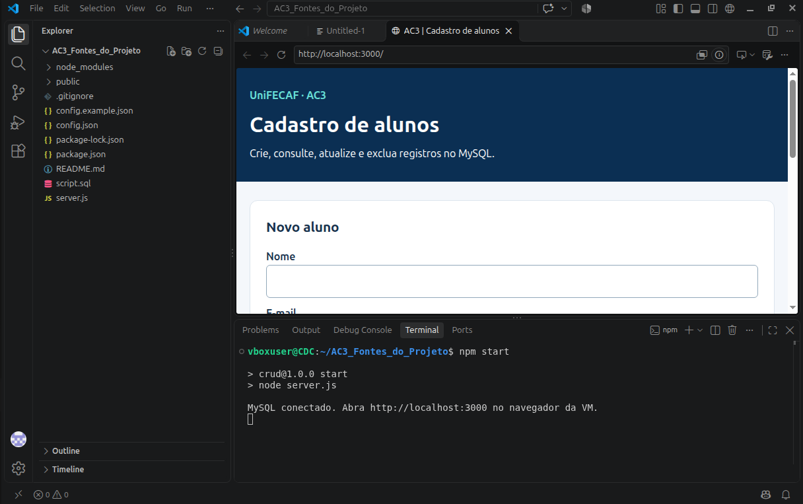
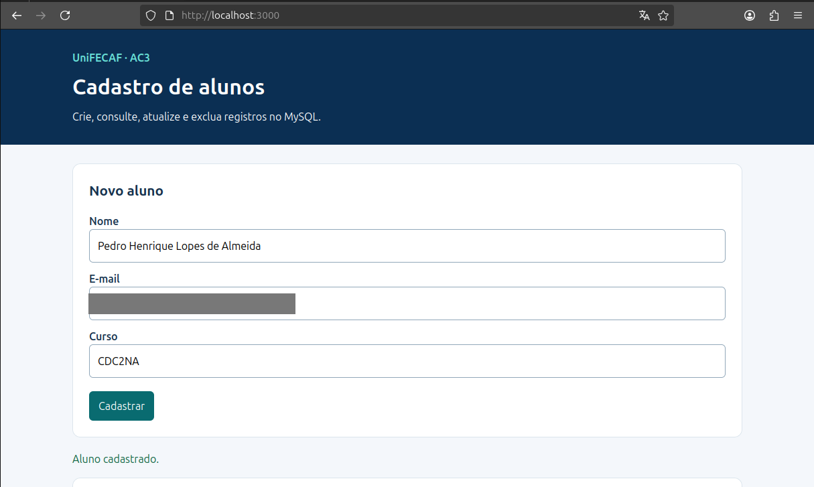
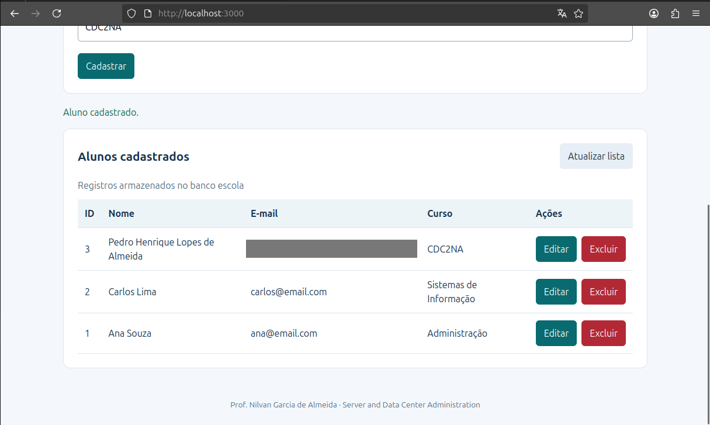
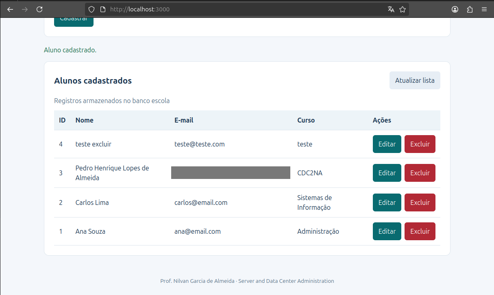
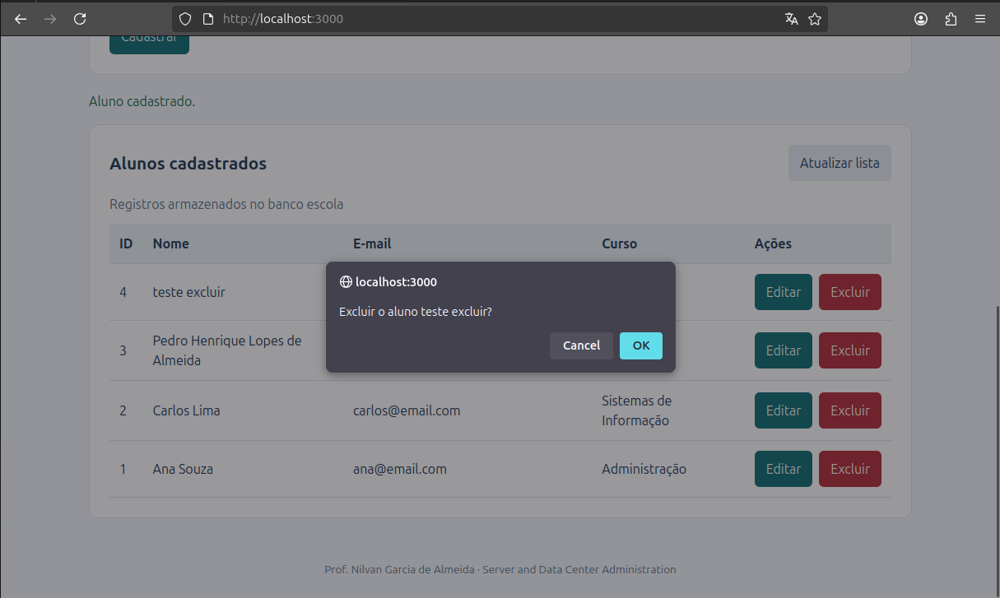
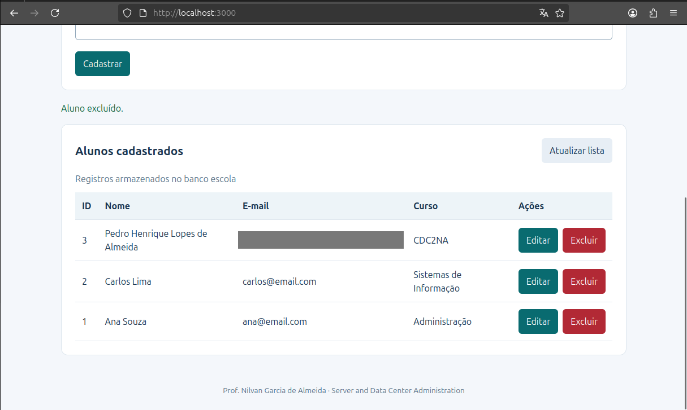
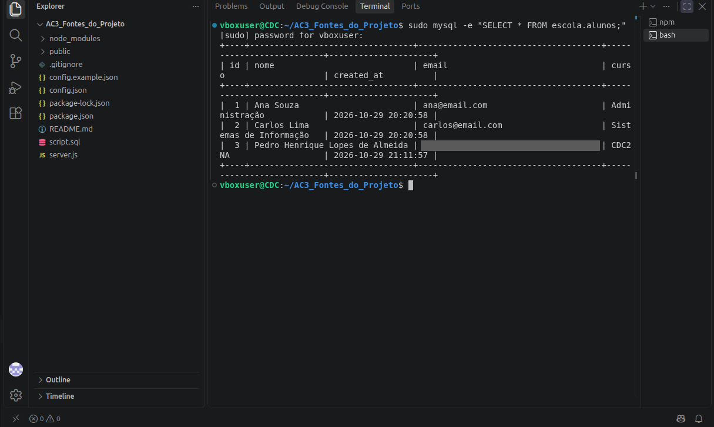

# CRUD de Alunos: Node.js + MySQL em VM Ubuntu

Atividade prática **AC3** da disciplina *Server and Data Center Administration*, **UniFECAF** (prof. Nilvan Garcia de Almeida).

Aplicação web de cadastro de alunos com as quatro operações de um CRUD (**C**reate, **R**ead, **U**pdate, **D**elete), executada com o banco de dados em uma máquina virtual Ubuntu.

> O código-fonte da aplicação foi fornecido pelo professor. A minha parte foi preparar o ambiente (VM, MySQL, Node.js), configurar, executar e testar a aplicação. O roteiro original está em [`docs/roteiro-original.md`](docs/roteiro-original.md).

## Arquitetura

```
Navegador (Firefox da VM)
        │  HTTP  /alunos  (JSON)
        ▼
Node.js + Express  ── server.js   (porta 3000)
        │  mysql2 (consultas parametrizadas)
        ▼
MySQL 8.0  ── banco "escola", tabela "alunos"
```

Tudo roda em **uma VM** (VirtualBox, Ubuntu 24.04 LTS). O navegador só fala com o servidor Node.js; apenas o servidor acessa o MySQL.

## Tecnologias

| Camada | Tecnologia |
| --- | --- |
| Sistema | Ubuntu 24.04 LTS em VirtualBox |
| Banco de dados | MySQL Server 8.0 |
| Back-end | Node.js 22, Express 4, mysql2 |
| Front-end | HTML, CSS e JavaScript |
| Editor | Visual Studio Code |

## Rotas da API

| Método | Endereço | Ação |
| --- | --- | --- |
| GET | `/alunos` | Lista os alunos |
| POST | `/alunos` | Cadastra um aluno |
| PUT | `/alunos/:id` | Atualiza um aluno |
| DELETE | `/alunos/:id` | Exclui um aluno |

## Como executar (Ubuntu)

```bash
# 1. Dependências do sistema
sudo apt update
sudo apt install -y mysql-server
curl -fsSL https://deb.nodesource.com/setup_22.x -o nodesource.sh
sudo bash nodesource.sh
sudo apt install -y nodejs

# 2. Banco de dados (troque SUA_SENHA no script antes)
sed -i "s/DEFINA_A_SENHA_DO_USUARIO/SUA_SENHA/" script.sql
sudo mysql < script.sql

# 3. Configuração
cp config.example.json config.json
sed -i "s/DEFINA_A_SENHA_DO_USUARIO/SUA_SENHA/" config.json

# 4. Executar
npm install
npm start
```

Depois, abra **http://localhost:3000** no navegador da VM.

> `config.json` contém a senha do banco e está no `.gitignore`: ele não vai para o repositório.

## Evidências

| Etapa | Print |
| --- | --- |
| Ambiente instalado (Node, npm, MySQL ativo, VS Code) |  |
| `npm install` e `npm start`: "MySQL conectado" |  |
| Projeto no VS Code com a aplicação rodando |  |
| **Create**: cadastro de aluno |  |
| **Read**: lista de alunos |  |
| **Delete**: registro de teste, confirmação e exclusão |    |
| Conferência no MySQL (`SELECT * FROM escola.alunos;`) |  |

## Autor

**Pedro Henrique Lopes de Almeida** · UniFECAF · turma CDC2NA
